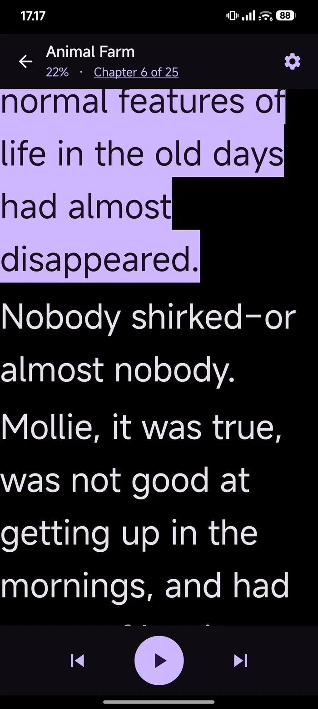
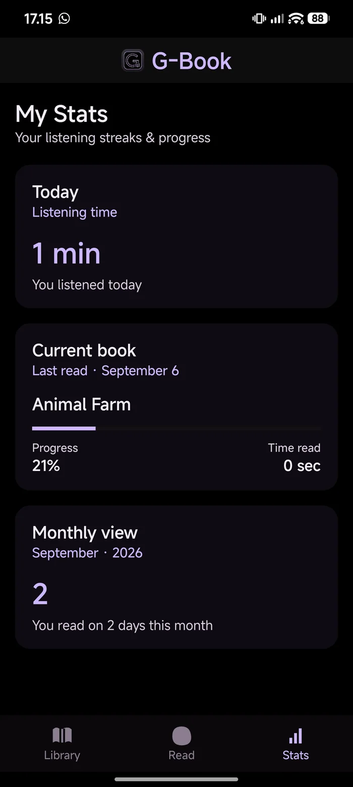
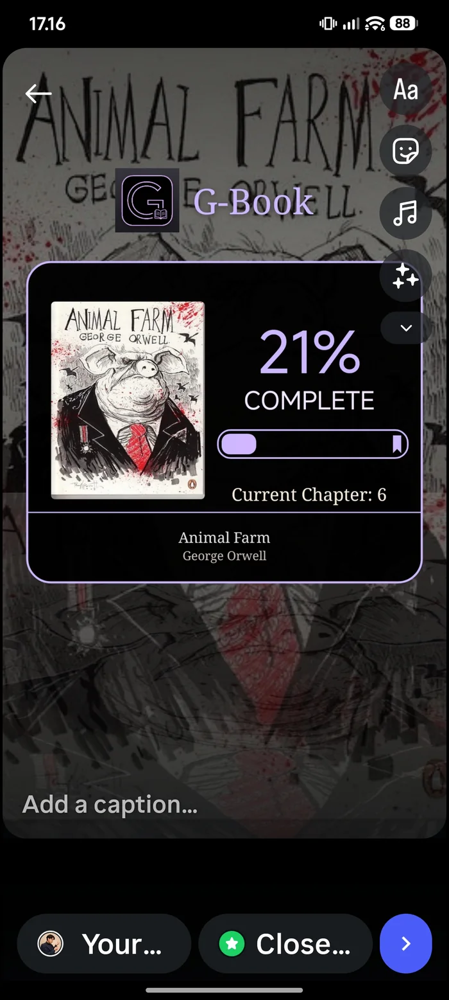

# G-Book

An Android ebook reader that reads to you. Built for low vision, from the first line of code.

**Landing page:** https://gerryksyn.github.io/g-book/
**Download:** [G-Book-v0.6.2.apk](docs/assets/apk/G-Book-v0.6.2.apk) · 18.6 MB · Android 8.0+

   

---

## What it is

G-Book is a native Android reading app with text-to-speech built in. Large type, real
sentence-level highlighting, EPUB and PDF support, and nothing standing between you and
the words.

I have low vision, so this is the reader I actually needed. Then I kept rebuilding every
time something got in the way of the words.

## Features

- **Reads aloud, properly.** TTS runs in a foreground service with a media session, so
  playback survives screen-off and shows a notification with cover art, book title,
  chapter, and previous / play / next-sentence controls.
- **Sentence-level highlight.** The spoken sentence is lit in light purple and kept in
  view as the reader auto-scrolls.
- **Type you actually control.** 16–44sp, font weight and line spacing in quarter
  increments, serif or sans, centred or justified, one to three blank lines between
  paragraphs.
- **True black, real contrast.** AMOLED-black surface by default, with an ink-on-paper
  high-contrast mode when you want the opposite.
- **EPUB done right.** EPUB 3 navigation documents and EPUB 2 NCX both parse, the OPF
  spine decides reading order, chapter anchors are exact, and malformed files still open.
- **PDF, too.** Text is extracted for reading and speaking, with the first page rendered
  as the cover.
- **One source of progress.** Reader, library, stats, the notification, shared cards and
  CSV backups all read from the same progress model.
- **Stats that count listening.** Today's actual spoken time, the current book with
  chapter and percentage, and reading days this month. CSV backup and restore.

## Accessibility

The reason the app exists, so it gets its own section:

- Volume keys step sentence-by-sentence in full-screen reading instead of changing volume.
- A tap hides all chrome so the page is only text; nothing overlaps the words.
- The reader keeps its own locked type scale, so large sizes don't collapse the layout
  into clipped lines.
- Resumes on the exact sentence it left, scrolled into view.
- Everything is real scalable type. Nothing is a picture of text.

## Download

| | |
|---|---|
| Version | 0.6.2 (versionCode 21) |
| Requires | Android 8.0 (API 26) or newer |
| Targets | Android 14 (API 34) |
| Package | `id.gerry.gbook` |
| Size | 18.6 MB |
| SHA-256 | `9ea237097ee7c039803adbb68ef9926b93ebef0191539c1dbe4ec60ca9ddf264` |

The APK is signed with a **private release key**, not a debug key, but it is still
distributed outside any app store, so Android will ask you to allow installs from this
source. Verify the SHA-256 if you want to be sure the file arrived intact. G-Book needs
no account and no network to read.

> **Upgrading from the earlier debug build?** The signing key changed, so Android will
> refuse to install over it. Back up your progress from Stats, uninstall the old copy,
> install this one, then restore.

## Build from source

Requires **JDK 17** (JDK 21 works too) and the Android SDK with platform 34.

```bash
git clone https://github.com/gerryksyn/g-book.git
cd g-book

# point Gradle at your SDK
echo "sdk.dir=$ANDROID_HOME" > local.properties

./gradlew clean :app:testDebugUnitTest :app:assembleDebug
```

The debug APK lands in `app/build/outputs/apk/debug/app-debug.apk`.

For a release build:

```bash
./gradlew :app:assembleRelease
# → app/build/outputs/apk/release/app-release.apk
```

Release signing reads `keystore.properties` from the repo root, which is **git-ignored**:

```properties
storeFile=/absolute/path/to/gbook-release.jks
storePassword=…
keyAlias=gbook
keyPassword=…
```

Without that file the release build still compiles, just unsigned, so a fresh clone
never breaks. The keystore itself is never in this repository, and it should never be:
anyone holding it can publish an update that Android will install over the real app.
Losing it means every existing install has to be uninstalled and replaced by hand.

`local.properties` is git-ignored too. It holds a machine-specific SDK path.

Shipping a version is documented step by step in [RELEASING.md](RELEASING.md): the version
bump, signing, checksums, the site update and the GitHub release.

## Project structure

```
.
├── app/                        the Android application module
│   └── src/
│       ├── main/java/id/gerry/gbook/
│       │   ├── MainActivity.kt          library host, navigation, volume keys
│       │   ├── SplashActivity.kt        splash → main
│       │   ├── GBookStore.kt            import, EPUB/PDF parsing, covers, persistence
│       │   ├── Parsed.kt  Book.kt       models and text helpers
│       │   ├── ChapterProgress.kt       progress model
│       │   ├── EpubNavigationParser.kt  EPUB 3 nav + EPUB 2 NCX
│       │   ├── ProgressBackup.kt        CSV backup and restore
│       │   └── ui/
│       │       ├── library/             grid/list, cover art, sort, menus
│       │       ├── reader/              reader surface, TTS engine, playback service
│       │       ├── share/               1080×1920 story card
│       │       ├── stats/               today / current book / monthly
│       │       └── theme/               AMOLED theme, motion
│       └── test/java/id/gerry/gbook/    unit tests
├── docs/                       the landing page, served by GitHub Pages
├── RELEASING.md                how to cut and publish a version
├── build.gradle.kts
├── settings.gradle.kts
└── gradle.properties
```

Unit tests cover the parts that are easy to get wrong: EPUB navigation parsing, chapter
progress maths, and the CSV backup format.

## Tech

Kotlin · Jetpack Compose · Material 3 · MediaSessionCompat (foreground TTS service) ·
PdfBox-Android · Gson · JUnit.

`minSdk 26` · `targetSdk 34` · `compileSdk 34` · JVM 17 · Compose BOM 2023.10.01.

## Changelog

**0.6.2**: reader top bar reworked so Share and Settings stay fully visible; strict
one-line ellipsis on book and chapter titles; bottom-origin slide-up when a book opens;
motion timed to the highest supported refresh rate; Library is the destination for every
fresh launch.

**0.6.1**: durable exact TTS resume, restored sentence scrolled into view, unified
motion and ripple polish.

**0.6.0**: reader settings split into Page / TTS tabs; library detail typography
auto-sizes before it ellipsizes.

**0.5.7**: Page and TTS settings separated, quarter-step font weight and pitch, details
sheet that adapts to locked font scale.

**0.5.6**: hierarchical EPUB navigation, exact chapter anchors, paused TTS seeking,
synchronised chapter identity.

## Known limitations

- Signed with a self-generated release key, not a Play Store key, so no store distribution.
- Installing this build over an earlier debug-signed one requires an uninstall first.
- EPUB and PDF only. No MOBI, AZW3 or CBZ.
- TTS quality and available voices depend on the voices installed on the device.
- No sync between devices; progress lives on the phone and in CSV backups.

## License

No license file yet, so all rights reserved for now. Open an issue if you'd like to use
part of it and we'll sort something out.

---

Made by [Gerry](https://github.com/gerryksyn). Free to use, works offline, collects nothing.
